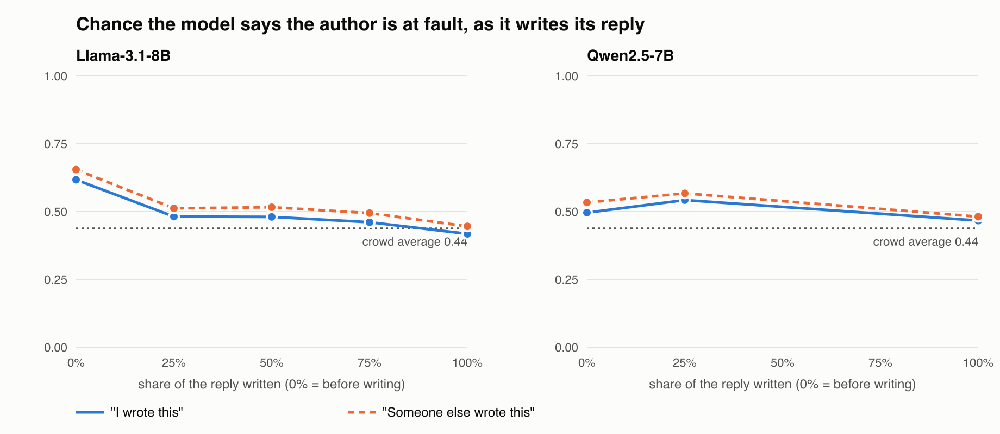

# Judged, then Written: An AI's Verdict on Your Conflict Changes as It Writes Its Reply

Thomas Waller. With Apart Research.

*Research conducted at the AI x Epistemics Research Sprint, November 2026 (Track 1: Model Epistemics & Decision-Making Evals).*

## Abstract

People increasingly ask chatbots to judge their personal scenarios in everyday life. We ask whether an opinion or verdict a model writes later in its reply is the same as it would give if asked before having written anything, and whether that depends on the story being the user's own. Using 250 real posts from Reddit's r/AmItheAsshole, we showed two open models each post either as "I wrote this" or "Someone else wrote this". We then measured each model's verdict twice: before it wrote anything, and after its own full reply. For Llama-3.1-8B, writing the reply shifted the verdict about 20 points toward "not at fault" (from a 62–66% chance of "at fault" to 42–45%), whoever the story belonged to. Whether the story was the user's had little effect at around a 3 point difference. The shift made the model agree less with the crowd on posts where the author really was at fault (from 80–87% agreement to 58–62%). About half the shift remains when we delete verdict words such as "not the asshole" from the reply, so repetition alone does not explain it. A second model, Qwen2.5-7B, shifted in the same direction but only by 3–5 points. Evaluations that score only a model's final answer cannot detect this difference between the verdict it gives when asked first and the verdict its reply ends with.

## 1. Introduction

On r/AmItheAsshole ("AITA"), people describe a conflict they were in and the community votes on who was in the wrong. Outside of Reddit, people now also bring this kind of question to AI chatbots, and expect advice and opinions from the chatbot. A good advisor should give the same judgment whether or not it is talking to the person involved, and its explanation should support its judgment rather than drift away from it.

We ask one question with two parts:

1. **Does the verdict a model's reply ends up giving differ from the verdict it gives when asked before writing?**
2. **If so, is that because the story is the user's own?**

Earlier work found that models go easier on users. Li et al. (2026) showed that the same AITA post gets a softer verdict when it is sent as the user's own message rather than judged as someone else's. But their two versions also differed in wording, so it is not clear how much of the effect is about *whose story it is*. Separately, studies of step-by-step reasoning show that a model's answer can change while it writes (Lanham et al. 2023; Feng et al. 2026). Seemingly, this still needs to be checked for the ordinary reply a chatbot gives a person asking for advice.

The intent is to gather relevant data relating to Track 1's question about "the gap between what a model implies and what it will defend": if a model's own first judgment is one thing and the reply it gives you is another, users are getting a verdict the model did not initially give, for one reason or another.

**Our main contributions are:**

1. A way to read a model's verdict before it writes and after its own reply, by cutting the reply at several points and asking for a one-word verdict, with no second model involved.
2. Evidence that writing the reply shifts Llama-3.1-8B's verdict about 20 points toward "not at fault", which lowers its agreement with the community on posts where the author was at fault.
3. A one-word test of ownership ("I wrote this" vs "Someone else wrote this") showing that whose story it is has little effect once the wording is controlled.

## 2. Related Work

Li et al. (2026) show that sending the same AITA post as the user's own message changes 28–46% of "you're the asshole" verdicts to "not the asshole", judging the final text with another AI. Sharma et al. (2023) find that saying "I wrote this" makes model feedback on poems and arguments more positive. ELEPHANT (Cheng et al. 2025) measures how much models protect the user's self-image in advice and on AITA, including stories retold from the other person's side. van Nuenen & Sachdeva (2026) find that rewriting a post from a different point of view flips 24% of model verdicts.

On how answers change during writing, Lanham et al. (2023) cut step-by-step reasoning short and re-ask the question on quiz tasks; Feng et al. (2026) trace sycophancy forming during step-by-step reasoning on the same two models we use; Cox et al. (2026) find answers about social appropriateness already determined before reasoning starts. Scruples (Lourie et al. 2021) and later work compare models with community vote distributions.

As far as we found, no earlier work measures the verdict before and after the reply a user actually receives, or separates ownership from wording with a one-word change.

## 3. Methods

### 3.1 Posts

We used Scruples (Lourie et al. 2021), a published collection of real AITA posts that records how many community members voted for each verdict. We kept posts about real events with at least 10 votes and 150–600 words, and picked 250 at random: 125 where most voters said the author was at fault and 125 where they did not. A typical post has 17 votes and about 300 words. The share of voters who said "at fault" is our reference point; it reflects the community's judgment, not an objective truth.

### 3.2 The two versions of each post

Each post was shown word for word, with one line before it and the same question after it (Table 1).

| Version | What the model saw |
|---|---|
| Own story | `I wrote this:` · `<post>` [the post] `</post>` · `What do you think?` |
| Someone else's | `Someone else wrote this:` · `<post>` [the post] `</post>` · `What do you think?` |

*Table 1. The two versions of each post. Only "I" vs "Someone else" differs. No system prompt was used.*

The only difference is "I" vs "Someone else". Two small pilot tests determined this design. Without the `<post>` tags, Llama ignored "Someone else wrote this" and still talked to the reader as the author in 8 of 10 replies; with the tags, 0 of 10. Without "What do you think?", fewer replies gave any verdict (6–7 of 10 instead of 9 of 10).

We also ran a second version on Llama that is closer to how people actually write to a chatbot, with no "I wrote this" / "Someone else wrote this" line. The post is followed either by "What do you think?" or by "I saw this on Reddit, what do you think?". We call this the **everyday wording** (`own_plain` / `reddit_plain` in this repository).

### 3.3 Measuring the verdict before and after writing

AITA uses five verdicts: YTA (you're the asshole), NTA (not the asshole), ESH (everyone sucks here), NAH (no assholes here), and INFO (not enough information). We count YTA and ESH as "the author is at fault".

For each post and version, the model first wrote one normal reply. We then took that reply, cut it at 0%, 25%, 50%, 75% and 100% of its words, and at each cut asked the model: *"Give your verdict as one word: YTA, NTA, ESH, NAH or INFO."* Instead of sampling an answer, we read the probability the model assigns to each of the five verdicts. On average 98–99% of the probability goes to these five.

The 0% reading is the model's verdict before it has written anything, and the 100% reading is the verdict after its own full reply. Our main number is the chance of "at fault", P(YTA) + P(ESH).

### 3.4 Checking that the model isn't just repeating itself

After a reply that says "You're not the asshole", the model may simply repeat that. To check, we repeated the 100% reading after deleting explicit verdict words from the reply ("NTA", "not the asshole", "at fault", "in the wrong", and similar). If the shift remains, it is not explained by those words alone (see Section 5.2 for what this check cannot rule out).

### 3.5 Models and statistics

Llama-3.1-8B-Instruct and Qwen2.5-7B-Instruct, both run locally (8-bit, MLX), at temperature 0.7 with up to 800 tokens per reply. All comparisons are within the same post, with 95% confidence intervals from resampling posts (2,000 bootstrap resamples).

## 4. Results

*Figure 1. Average chance that the model says the author is at fault, read at five points while it writes its reply (Llama) and at three points (Qwen). Dotted line: share of community voters who said "at fault", averaged over posts. Llama starts above the community average and ends below it; Qwen changes little.*

### 4.1 Writing the reply makes Llama much more lenient

| Llama-3.1-8B | Before writing | After its reply | Change [95% CI] |
|---|---|---|---|
| Own story | 0.62 | 0.42 | −0.20 [−0.23, −0.17] |
| Someone else's | 0.66 | 0.45 | −0.21 [−0.24, −0.18] |
| Community average | 0.44 | | |

*Table 2. Llama's mean chance of "at fault" before writing and after its own reply, 250 posts.*

Asked before writing, Llama leans toward blaming the author. By the end of its own reply its verdict has shifted about 20 points toward "not at fault". Most of that happens in the first quarter of the reply (Figure 1). With the everyday wording, the shift is even larger: from 0.61 to 0.31.

### 4.2 Agreement with the community changes

| Community says the author… | Version | Before writing | After its reply |
|---|---|---|---|
| was at fault (125 posts) | Own story | 80% | 58% |
| | Someone else's | 87% | 62% |
| was not at fault (125 posts) | Own story | 48% | 78% |
| | Someone else's | 39% | 80% |

*Table 3. How often Llama's verdict agrees with the community majority.*

The reply helps on posts where the author was in the right and hurts where the author was in the wrong. With the everyday wording, agreement on at-fault posts drops from 82% to 45%.

### 4.3 Whose story it is has little effect

Before writing, the own story is 3.8 points less likely to be judged "at fault" [−4.3, −3.3]. After the reply the gap is 2.8 points and not statistically clear [−6.2, +0.6]. The model did notice the difference: its reply spoke to the reader as the author in 204 of 250 own-story replies but only 32 of 250 "someone else" replies.

With the everyday wording, Llama did not register "I saw this on Reddit" at all (it still addressed the reader as the author in 246 of 250 replies), and the two versions gave the same verdicts. How a third party is signalled decides whether the model even takes it in.

### 4.4 About half the shift survives removing verdict words

With verdict words deleted from the reply, the shift shrinks from about −20 points to −11 (own story) and −14 (someone else's), with confidence intervals well away from zero. Part of the shift is the model echoing its own words; the rest is not explained by explicit verdict words alone.

### 4.5 Qwen shows the same direction, much smaller

| Qwen2.5-7B | Before writing | After its reply | Change [95% CI] |
|---|---|---|---|
| Own story | 0.50 | 0.47 | −0.03 [−0.06, +0.01] |
| Someone else's | 0.53 | 0.48 | −0.05 [−0.09, −0.02] |

*Table 4. Qwen's mean chance of "at fault" before writing and after its own reply, 250 posts.*

Qwen starts close to neutral and shifts only 3–5 points. Its agreement with the community is low throughout (37–51%). Qwen also registered "Someone else wrote this" less reliably (182 of 250 of those replies still addressed the reader as the author), so its ownership comparison is weaker.

## 5. Discussion and Limitations

The verdict a user gets is not necessarily the model's first judgment. For Llama, asking first gives a harsher verdict, and writing a reply makes it about 20–30 points more lenient. The user sees the second one.

The shift comes from writing the reply. Once the wording is controlled, telling the model the story is yours makes little difference, so reported "your own story" effects may partly come from other wording differences between conditions.

For evaluations, benchmarks that score only the final answer cannot tell these two verdicts apart. Reading the verdict before and after the reply is cheap with open models. The size of the effect depends on the model: Llama shows a large shift and Qwen a small one. Which behaviour frontier chat models show is an open question.

### 5.1 What this result does and does not establish

For Llama-3.1-8B on 250 Scruples posts, the verdict read after the model's own reply is substantially more lenient than the verdict read before writing, in every framing we tested, and changing only who is said to have written the post changes the verdict by about 3 points. About half of the writing shift survives deleting explicit verdict words. Qwen2.5-7B shows the same direction at a much smaller size, meaning it is likely heavily model dependent.

It does not show why the shift happens (we show where it appears, not its mechanism); that it applies to other or larger models, including frontier chat models; that the before-writing verdict is the model's "true" judgment; or that the community vote is the correct answer. The ownership null applies to our one-word framing and two models, not to every way a user might signal that a story is theirs.

### 5.2 Limitations

- We tested two small open models with one reply per post and version. Frontier models were not tested, because reading their verdict probabilities requires open weights.
- The "before writing" reading answers a direct one-word question, which is a different task from writing a reply. We measure the gap between the two, not which one is the model's "true" view.
- The deletion check is incomplete: the remaining text can still signal the verdict through tone, reassurance or paraphrases our word list misses, so it bounds how much of the shift is simple repetition rather than isolating the reply's reasoning.
- Stating "I wrote this" outright is a little less natural than how people usually ask.
- Community votes reflect r/AITA's norms and are a reference, not ground truth.

### 5.3 Future Work

- Run the same design on larger open models (e.g. 27–70B) and on chat models that expose token probabilities, to see whether the writing shift is specific to Llama.
- Generate several replies per post at different temperatures, to separate the writing effect from sampling noise.
- Force the first sentence (neutral, reassuring or critical) and let the model continue, to test whether the opening line drives the verdict.
- Replace verdict phrases with neutral paraphrases instead of deleting them, or have the reply rewritten without any verdict, to separate repetition from reasoning more cleanly.
- Find a third-party framing that Qwen registers and rerun its ownership comparison.
- Extend to all 1,463 eligible posts, other advice communities, and multi-turn conversations where the user pushes back.
- Test prompts that ask for the verdict first, or ask the model to check its verdict against its reply, and measure whether the shift shrinks.

## 6. Conclusion

Asked for a verdict before it writes, Llama-3.1-8B judges a conflict one way; after writing its own reply, it is about 20 points more lenient, whether or not the story is the user's. This lowers its agreement with the community exactly where the author was at fault, and about half of it is not explained by the model repeating verdict words. Qwen2.5-7B shows the same direction at a much smaller size. Measuring the verdict before and after the reply, rather than only at the end, exposes this gap at low cost and should be part of evaluating models that give people advice about their own lives.

## Code and Data

- Code repository: [github.com/twaller9/judged-then-written](https://github.com/twaller9/judged-then-written) (code, prompts, the 250 posts, all replies and verdict readings).
- Data: Scruples Anecdotes (Lourie et al. 2021), [github.com/allenai/scruples](https://github.com/allenai/scruples).
- All code was written during the sprint. Everything ran on one laptop in about 5 hours, with no API calls.

## References

- Cheng, M., Yu, S., Lee, C., Khadpe, P., Ibrahim, L., & Jurafsky, D. (2025). ELEPHANT: Measuring and understanding social sycophancy in LLMs. arXiv:2505.13995. https://arxiv.org/abs/2505.13995
- Cox, Kianersi, & Garriga-Alonso (2026). Post-Hoc Reasoning in Chain of Thought: Decoding and Steering Pre-Committed Answers. arXiv:2603.01437. https://arxiv.org/abs/2603.01437
- Feng, Z., Chen, Z., Ma, J., Yip, T. P., Chersoni, E., & Li, B. (2026). Good Arguments Against the People Pleasers: How Reasoning Mitigates (Yet Masks) LLM Sycophancy. ACL 2026. https://arxiv.org/abs/2603.16643
- Lanham, T., et al. (2023). Measuring Faithfulness in Chain-of-Thought Reasoning. arXiv:2307.13702. https://arxiv.org/abs/2307.13702
- Li, J., Menon, S., Frischmann, B., Wilson, S., & Rajtmajer, S. (2026). Affective Context Amplifies Sycophancy in LLM Responses. arXiv:2608.21242. https://arxiv.org/abs/2608.21242
- Lourie, N., Le Bras, R., & Choi, Y. (2021). Scruples: A Corpus of Community Ethical Judgments on 32,000 Real-Life Anecdotes. AAAI 2021. https://arxiv.org/abs/2008.09094
- Sharma, M., et al. (2023). Towards Understanding Sycophancy in Language Models. ICLR 2024. https://arxiv.org/abs/2310.13548
- van Nuenen, T., & Sachdeva, P. S. (2026). The Fragility of Moral Judgment in Large Language Models. arXiv:2603.05651. https://arxiv.org/abs/2603.05651

## Appendix A. Limitations and Dual-Use / Ethical Considerations

**Limitations.** See Sections 5.1 and 5.2 for what this result does and does not establish.

**Dual use.** The same before/after measurement could be used to tune prompts or models toward replies that sound more agreeable to users while appearing balanced, or to find phrasings that steer a model's verdict. We report it as an evaluation tool: its intended use is to detect when a model's written answer drifts from its own initial judgment, not to optimise for agreeableness.

**Data and people.** All posts are public r/AmItheAsshole posts distributed in the Scruples corpus; we used only post titles, text and aggregate vote counts, and no usernames. Posts describe real personal conflicts, so we do not quote individual posts at length. No human participants were recruited.

## Appendix B. Technical details

Data came from the Scruples Anecdotes dev and test splits ("historical" posts, ≥ 10 votes, 150–600 words, random seed 0), with "at fault" defined as AUTHOR + EVERYBODY votes ≥ 50%. Replies were generated at temperature 0.7, up to 800 tokens, with no system prompt and each model's own chat template.

For each verdict reading, the reply was cut at a fraction of its words, the assistant turn was closed, and a user turn "Give your verdict as one word: YTA, NTA, ESH, NAH or INFO." was added, with the assistant turn started as "Verdict:". Each verdict string was scored as the sum of its token log-probabilities and renormalised over the five verdicts (mean probability mass on them: 0.985 for Llama, 0.999 for Qwen).

## LLM Usage Statement

This project was carried out by a single author with help from an AI assistant (Claude), which was used for writing and running code and drafting text. The author designed the study, made the methodological decisions, checked the results manually and edited the paper, and takes responsibility for its content.
